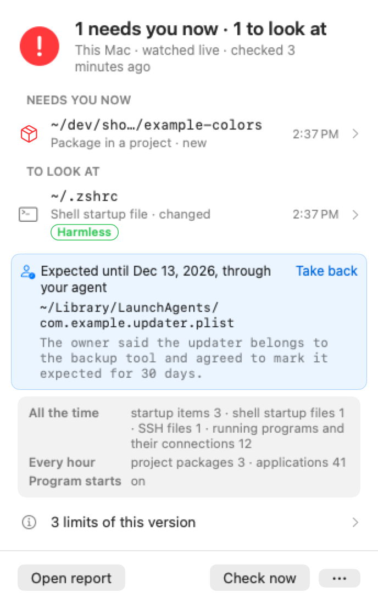
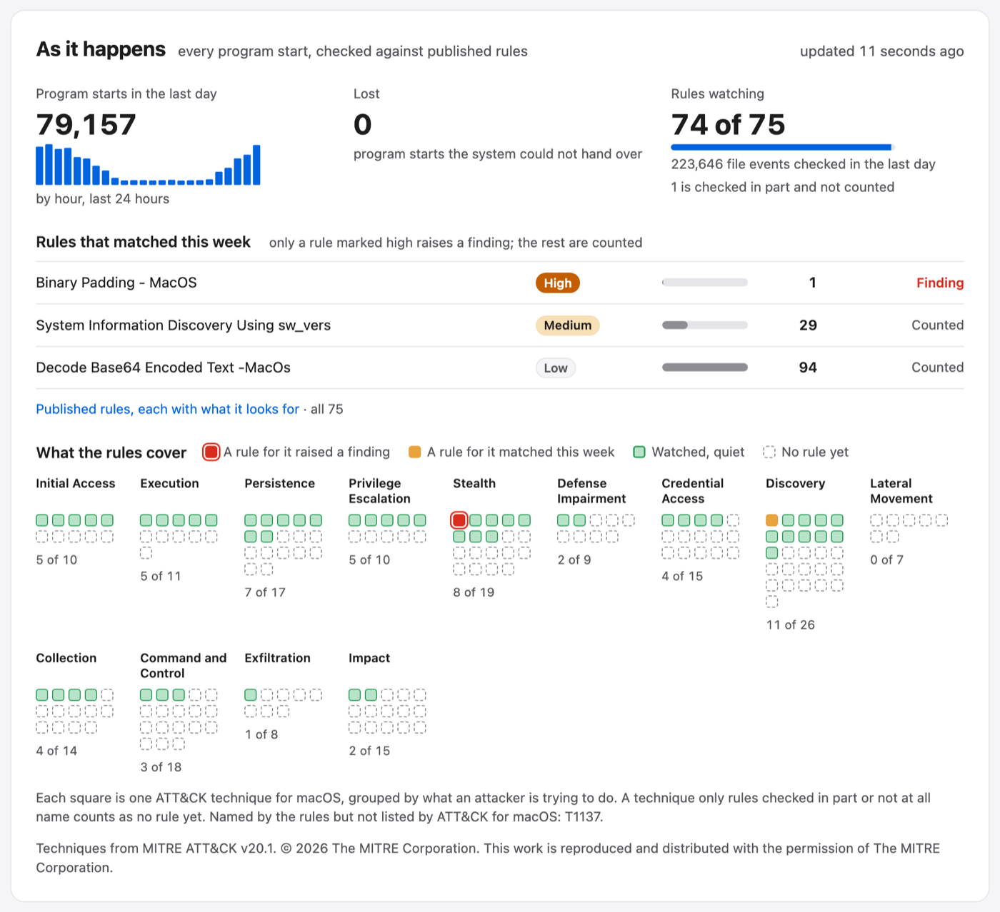
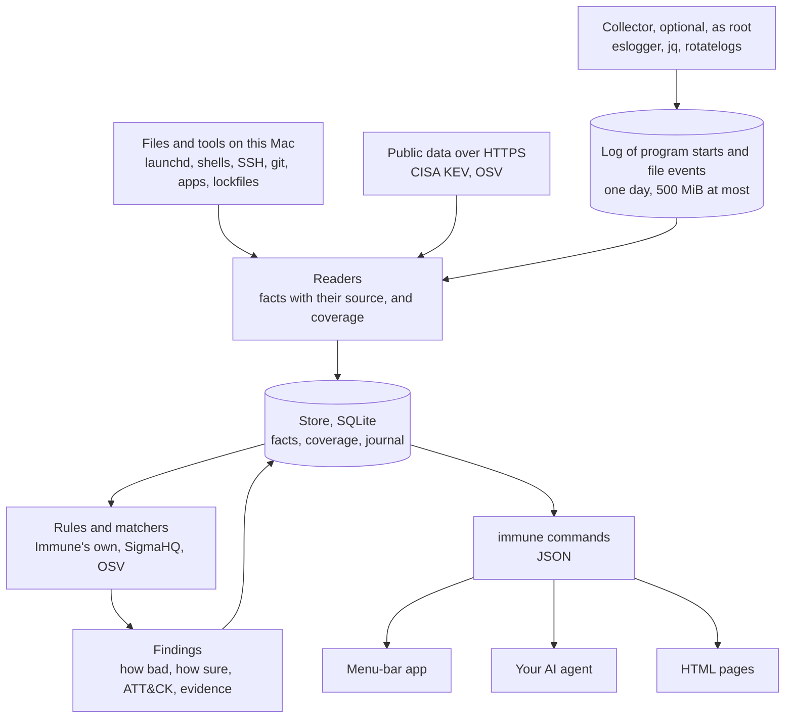

# Immune

Immune watches one Mac for signs of attack and tells you, or your AI coding agent, what it found and what it could not see. It is for a person who builds software with AI agents on their own Mac and has no security team behind them.

Immune is the detection core of [Artificial Immunity](https://immunity.bot), a project of [Nuanu AI Lab](https://nuanu.ai).

<p align="center">
  <picture>
    <source media="(prefers-color-scheme: dark)" srcset="docs/img/panel-dark.png">
    
  </picture>
</p>

It is one Rust program with SQLite built in, a small menu-bar app, and an optional collector made only of programs that macOS ships. It finds what you have on the Mac: projects and their dependencies, installed apps and packages, the places where persistence lives, the servers your SSH configuration knows. It matches dependencies against published vulnerability data (OSV and CISA's catalogue of exploited vulnerabilities), checks every program start and every file created or renamed against SigmaHQ's published rules for macOS, and raises findings tagged with MITRE ATT&CK techniques. Each finding says how bad it would be and how sure Immune is, as two separate values. Every answer also says what Immune could not see. There is no model inside, and nothing about your Mac is sent anywhere.

The pictures here are drawn by the program from an invented Mac.

## First run

You need an Apple Silicon Mac with macOS 15 or later, Apple's Command Line Tools (`xcode-select --install`) and Rust 1.89 or later (from https://rustup.rs, or `brew install rustup && rustup default stable`). You do not need an Apple developer account: the app is built and signed on your own Mac, so macOS opens it without asking.

```sh
git clone https://github.com/nuanu-ai/immune
cd immune
./build
open target/app/Immune.app
```

`./build` checks for what is missing and says how to install it; it installs nothing itself. The first build takes a minute or two.

The app lives in the menu bar. On first launch it asks once for permission to send notifications. The first check takes about a minute. While the app is open it watches the places where persistence lives as they change, looks at running programs every 30 seconds and runs a full check every hour. When you quit it, it stops. Details opens a page in your browser with everything it knows.

### Watching program starts and files

This step is optional and needs an administrator password. It installs a collector that records every program start on the Mac, with its arguments, and every file created or renamed, with its path and the program that did it, so that published rules can judge them. It needs macOS 15 or later, because it uses `/usr/bin/jq`.

```sh
sudo /bin/sh scripts/event-level/install
```

Then open System Settings, Privacy & Security, Full Disk Access, and allow `/usr/bin/eslogger`. Apple's `eslogger` refuses to start without it. The script ends with one line:

- `RESULT: RUNNING`: program starts and file events are being recorded.
- `RESULT: RUNNING IN PART`: program starts are being recorded, and no file event came in the ten seconds it waited. `immune status` says later whether file events are collected.
- `RESULT: REFUSED`: Full Disk Access is missing, so nothing is recorded. Once you allow it, the collector starts by itself within seconds.
- `RESULT: INSTALLED, NOT RECORDING YET`: nothing was written in ten seconds and `eslogger` printed no refusal.

The collector is three launch daemons, `ai.nuanu.immune.eslogger`, `ai.nuanu.immune.event-filter` and `ai.nuanu.immune.event-tidy`. They run only `eslogger`, `jq` and `rotatelogs` from macOS, with their scripts copied into `/Library/Application Support/ai.nuanu.immune/event-level`, a folder only root can write. A program's environment and a file's contents are never written. The log keeps one day and at most 500 MiB, and only root and the account that installed it can read it. The collector acts on no process, file or connection. To remove it with its logs:

```sh
sudo /bin/sh scripts/event-level/uninstall
```

### Updating and removing

To update, run `git pull`, quit the app from its panel, run `./build` and open the app again. `./build` refuses to run while the app is open.

To remove Immune, quit it, delete `Immune.app` and its data folder, `~/Library/Application Support/ai.nuanu.immune`, and run `defaults delete ai.nuanu.immune` to clear what it remembers about notifications. If you installed the collector, run the uninstall script above.

## What it watches

| What | How | When |
|---|---|---|
| Places where persistence lives: launch agents and daemons, zsh and bash startup files, `~/.ssh/config`, `authorized_keys` and `rc`, the system's SSH configuration, git hooks in every project | A checksum of each file, never its content | Within seconds while the app is open, otherwise at the hourly check |
| Software changed in place: app bundles, Homebrew kegs, global npm packages, code that apps keep under Application Support | The app's code signature, verified by macOS; for the rest, a digest of file paths and change times | Hourly |
| Files that make a tool run code by itself: install scripts in `package.json`, editor tasks that run when a folder opens, editor and dev container settings, coding agents' settings, hooks and MCP server lists, editor extensions | The part of the file that runs code, as a checksum. 13 of the 41 known ways in a project and 7 of the 11 known places in the home folder are read | Within seconds for most, hourly for the rest |
| Dependencies in `package-lock.json`, `pnpm-lock.yaml` and `Cargo.lock` | Matched against OSV's data for npm and crates.io and against CISA's catalogue | Hourly |
| Your running programs and their internet connections | Read without administrator rights. An interpreter given code on its command line and left running without a terminal is a finding | Every 30 seconds while the app is open |
| Every program start and every file created or renamed, with the collector | Checked against the 75 SigmaHQ rules for macOS: 74 are evaluated in full and 1 in part | About every 10 seconds while the app is open, and at every check |
| Indicators from an incident report that you give as `indicators.json`: SHA-256 hashes, domains, IPv4 addresses, URLs | Matched against watched files, lockfiles, editor tasks and connections | At every check |

A finding stays open until you answer it. "Expected" hides it for 30 days or a time you choose, with a reason; if it is found again meanwhile, it opens again when that time ends. "Seen" closes it. A finding that is high or critical in how bad and medium or high in how sure is urgent, and only then does the app send a notification.

A published rule marked high or critical raises one finding per rule, carrying the rule's title, authors, techniques and licence, with the latest matching program starts, or the file and the program that made it, as evidence. Matches of lower rules are counted and shown as a quiet row, never as an alarm. How sure such a finding is follows the rule's own status: medium for a stable rule, low otherwise.

<p align="center">
  <picture>
    <source media="(prefers-color-scheme: dark)" srcset="docs/img/rules-dark.png">
    
  </picture>
</p>

Servers are read only through a script you run yourself. `immune servers` lists the servers this Mac knows from your SSH configuration, known hosts and Tailscale, and writes a read-only sweep script; Immune itself never connects to a server.

## What it does not see

Immune names its own blind spots in every answer. Each reader records what it covered: in full, in part or not at all, with the reason. A source that does not exist on this Mac is "not applicable", which is not a failure. A source that exists but cannot be read is a failed reading with its reason. A missing reading is never taken as proof that nothing is there, so a reader that could not read a place removes nothing it knew about it.

For a vulnerability there are four answers: affects me; does not affect me, known for certain; does not affect me, no signs; don't know, with a reason from a closed list. "Known for certain" needs a full and fresh reading of the place and current data. A fact that rests only on text, such as a README or an agent's session, is weak and never supports it.

`immune status` lists what is not covered, one item per cause, and says who can act on each: `you` (a server you have not swept, a file whose permissions keep Immune out) or `nothing` (a limit of this version). Today those limits include:

- A connection at the moment it is made, and the name behind an address. Immune samples connections every 30 seconds and sees addresses only; `eslogger` has no network event.
- A file modified in place or removed. The collector records files created and renamed only.
- `fork` and `exit`: a process that forks without starting a new program, and when a process ends.
- One Sigma rule reads a field that `eslogger` does not give, so it is evaluated only in part.
- Without the collector: the moment a program starts, its command line, who started it, and which program created a file. The 75 Sigma rules then do not watch.
- Vulnerabilities in installed apps, Homebrew packages, what servers run, and projects in other languages. Lockfiles Immune has no reader for, such as `requirements.txt`, `uv.lock` or `go.sum`, are named in the report.
- Folders macOS asks permission for: Desktop, Documents, Downloads, iCloud Drive, other cloud storage, other apps' containers and anything under `/Volumes`. Immune never enters them, so macOS never shows you a permission dialog because of it, and the report says what was skipped.
- Which program changed a watched file in place.
- Stopping anything. Immune reports, and it never blocks, suspends or kills a program.

## How it works



Each reader writes statements with where it read them and how the source knows: observed (the thing itself), declared (a description tooling enforces, such as a lockfile) or mentioned (text). The parts talk to each other only through the store. A run writes a draft, and only a reading that covered a place in full can retract what it said before about that place. Every difference between runs is an entry in the journal, and a retracted statement is kept for later investigation. The app has no logic of its own. It shows what the commands return, so you and your agent see the same thing.

More detail: [how it works](docs/how-it-works.md), [what is read and every command](docs/reference.md), [threat data and matching](docs/threats.md), [the collector](docs/event-level.md).

## For AI agents

The first user of Immune is your coding agent, and the commands are its interface. Every report command that takes `--json` prints one envelope with `ok`, `errors` and `result`. `immune project`, `immune program`, `immune machine` and `immune matches` each print one protobuf message, or the same message as JSON with `--json`, and use the envelope only for a failure. Exit code 0 means answered, 1 from `immune matches` that the event log could not be read, 2 a misuse or an unknown id, 3 an unreadable store, 4 a check holding the store (ask again), and 5 from `immune watch` means another watcher has the store. Nothing asks an interactive question.

| Command | Answers |
|---|---|
| `immune status --json` | Whether this Mac is watched and quiet: what needs a look, what is not covered, what cannot be judged |
| `immune findings --json`, `immune finding <id> --json` | Findings with the journal entries each rests on (`rests_on`) |
| `immune finding <id> expected --reason <text> --via agent` | Your answer, given through the agent; also `seen` and `reopen` |
| `immune vulnerabilities --json`, `immune vulnerability <id> --json` | Known vulnerabilities in your projects' packages, and the answer for one record or CVE in every project, with what it rests on |
| `immune rules --json` | The shipped Sigma rules: which are evaluated in full, in part or not at all, with the reason, and how often each matched |
| `immune project <path> --json` | What Immune knows of one project: whether it knows it at all, its facts with what each rests on, which readings speak for it and whether each was full, and its findings |
| `immune program <path or name> --json` | The same for one installed app, Homebrew package or global npm package, found by a path inside it or by its name |
| `immune machine [<name>] --json` | The same for this Mac, or for a server or tailnet peer the Mac knows, with what is on it one level deep |
| `immune matches --json` | Every rule match over the collector's log, of every level, each with the program start or file event it matched and command lines whole; what was read, lost or not evaluated; and the position to read on from with `--after` |
| `immune watch` | One JSON line per event while it runs |

A trimmed answer from the invented Mac in the pictures:

```json
{
  "format": 1,
  "operation": "status",
  "ok": true,
  "errors": [],
  "result": {
    "needs_a_look": [
      {
        "id": "f89b204373f",
        "rule": "watched.autostart",
        "severity": "medium",
        "confidence": "low",
        "urgent": false,
        "technique": "T1543",
        "title": "A program set to start by itself on this Mac was added, changed or removed.",
        "where_text": "~/Library/LaunchAgents/com.example.updater.plist"
      }
    ],
    "not_covered": [
      {
        "id": "vulnerabilities-not-compared",
        "who": "nothing",
        "title": "Known vulnerabilities are not yet compared with your installed software, your servers or projects of other kinds."
      }
    ],
    "cannot_judge": [
      "no vulnerability is matched against installed software, servers' packages or ecosystems other than npm and crates.io yet"
    ]
  }
}
```

`title`, `meaning` and `advice` are Immune's own fixed words. Anything taken from the machine or from a feed, such as a path, a name or a reason someone typed, is returned only in a field whose name ends in `_text`, so an agent can treat it as data. A file on the Mac may have been written by an attacker for an agent to read.

The program is inside the app at `Immune.app/Contents/MacOS/immune`, and after `./build` also at `target/release/immune`. The skill in [`skill/immune/SKILL.md`](skill/immune/SKILL.md) tells an agent how to look into a finding read-only, explain it and the options to you, and give your answer only after you have agreed. For Claude Code, copy the folder to `~/.claude/skills/`. An answer given through an agent records that, with your reason; the app lists it, and you can take it back there.

## Where rules and data come from

| Source | What Immune takes | Licence | How it arrives |
|---|---|---|---|
| [SigmaHQ](https://github.com/SigmaHQ/sigma) | Every rule for macOS, 75 in all (70 over process starts, 5 over file events), byte for byte as published at commit `d7c9da1` | Detection Rule License 1.1, see [`rules/sigma/NOTICE`](rules/sigma/NOTICE) | Compiled into the program |
| [MITRE ATT&CK](https://attack.mitre.org) | The techniques for macOS and the 13 tactics of Enterprise ATT&CK, from release 20.1 | MITRE's ATT&CK licence, see [`rules/attack/NOTICE`](rules/attack/NOTICE) | Compiled into the program |
| [OSV](https://osv.dev) | Vulnerability and malicious package records for npm and crates.io, from sources such as the GitHub Advisory Database, RustSec and OpenSSF Malicious Packages | Each record keeps its source's licence; Immune names the source beside every record it shows | Downloaded: crates.io at every check, npm once a day |
| [CISA KEV](https://www.cisa.gov/known-exploited-vulnerabilities-catalog) | The catalogue of vulnerabilities known to be exploited | CC0 | Downloaded at every check |

These are the only requests Immune makes. They go through `/usr/bin/curl` over HTTPS, follow no redirect, and are the same for every user, so they reveal nothing about what is on your Mac. Matching happens on the Mac. Test data copied from other projects carries its own notice beside it, in `tests/osv/NOTICE` and `tests/semver/NOTICE`.

## Principles

- No model runs in collection, detection or the app, so the same input gives the same findings.
- Nothing about your Mac leaves it. Immune takes no command from the network and never connects to your servers.
- Rules come from published sets that others maintain and test. Immune writes its own only where none exists, for example for software changed in place.
- Every answer to a finding records who gave it (the app, an agent or the command line) and why, and an answer given outside the app stays listed in it until you take it back, so nothing is quieted silently. Answers are not signed: a program running as you could still rewrite the store directly.
- The 30-second sampler reads a command line only to decide one rule and keeps none. The collector's log holds arguments for one day, and the store keeps them only as the evidence of a finding, as they were.

## Artificial Immunity

[Artificial Immunity](https://immunity.bot) is a closed product from Nuanu AI Lab built on top of Immune. It decides what to do about a finding: triage with a model, response, handing work to an agent. It runs this binary unchanged and shares no code with it. What it reads and writes is defined by a protobuf schema in this repository, in `contract/immune/v1/`. So far the schema holds two messages. `immune project`, `immune program` and `immune machine` print what Immune knows of one project, program or machine, and `immune matches` prints what Immune concluded and is not sure of: every rule match with the event it matched, and what was read and lost. Its first version will also hold a verdict. Immune does not stream every event out. The other commands print their own JSON, the same one an agent uses. Immune works on its own and does not need Artificial Immunity.

## Status

Immune is early, and so far it has been built and verified on one Mac. It is built and tested only on Apple Silicon with macOS. The app is signed ad hoc by `./build` on the Mac that builds it, so there is no download yet.

The collector depends on `eslogger`, which Apple does not promise as an interface: its manual page says it "is NOT API in any sense". A macOS update may change what it prints. A line with a format version Immune does not know fails the reading. When the collector stops working, the status says so (`refused`, `failing`, `silent` or `failed`), and the rules are not shown as watching until it runs again.

Not built yet:

- Secrets cut out of the command lines Immune keeps and prints, with patterns from a published set. Today the command line of a matched program start is kept as the finding's evidence as it was, and `immune matches` prints it whole
- Grouping related findings into cases, and adding up weak rule matches
- Vulnerability matching for installed software, Homebrew and server packages
- A signed build for other Macs, and `immune` on your `PATH`
- Stopping or suspending anything

## Contributing, security and licence

See [CONTRIBUTING.md](CONTRIBUTING.md) for how to build, test and propose a change. Report vulnerabilities privately as described in [SECURITY.md](SECURITY.md), not in a public issue.

Immune is under the [MIT licence](LICENSE), copyright Nuanu AI Lab. Rules and data taken from others keep their own licences, given in the NOTICE file beside them.
