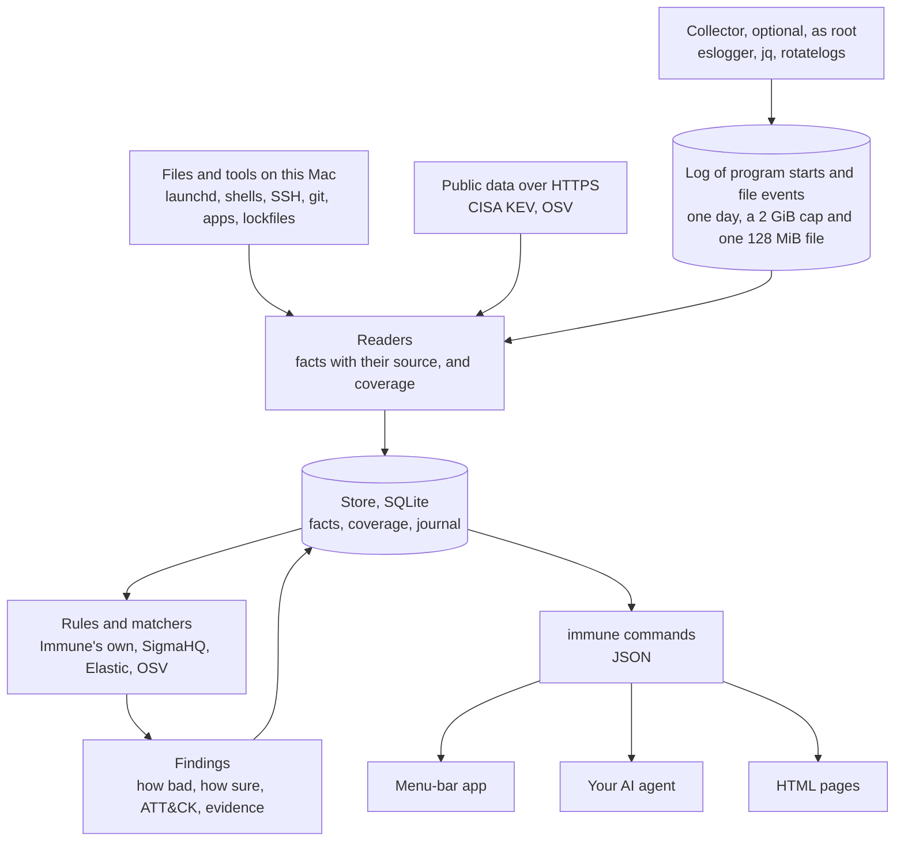

# How Immune works

Immune is one Rust program, `immune`, with SQLite compiled in, a menu-bar app that shows what the program returns, and an optional collector made of programs that macOS ships. This page describes how the parts fit: what Immune keeps, how a reading becomes a finding, and what a finding, a gap in coverage and an answer mean. [reference.md](reference.md) lists every reader, [threats.md](threats.md) covers vulnerabilities and indicators, and [event-level.md](event-level.md) covers the collector.

## The parts

```
Readers → Store → Rules and matchers → Findings → Store → Commands → App, agent, pages
```

- Readers look at one kind of source each: launch agents, shell profiles, lockfiles, installed applications, the SSH configuration, the collector's log, and so on. A reader writes statements about what it saw and a record of what it looked through.
- The store is one SQLite file, by default `~/Library/Application Support/ai.nuanu.immune/store.db`. Raw input the readers keep, the downloaded vulnerability data and the HTML pages live in the same folder.
- Rules and matchers read the store and write findings into it. Immune's own rules are plain Rust code. Published rules are evaluated by the `sigma-rust` crate: SigmaHQ's rules for macOS, shipped unchanged, and Elastic's detection rules and behaviour rules for macOS that translate into Sigma exactly over what the collector records. Matchers compare what the readers found with vulnerability data and indicator lists.
- Commands read the store and answer with one message of the contract: protobuf with `--proto`, JSON with `--json`, and text for a person rendered from the same message without either. Only `immune servers`, `immune view` and `immune watch` print something else. The app, the user's AI agent and the HTML pages all read the same commands.

The store is the one seam between the parts. What a reader saw, what a rule found and what a person answered are all rows in it, and the commands, the app and the pages read nothing else. No other layer or interface sits between the parts. That keeps any one of them replaceable: a collector, for example, can be swapped for another that writes the same facts.

The same flow, with what feeds each part:



## When things run

A full check, `immune run`, runs every reader once and then every rule. While the app is open it runs one every hour. `immune watch`, which the app keeps running as its child, does the faster work:

- it reads the places where persistence lives about a second after FSEvents reports a change there. First it reads only the readings whose places the change is in, each whole: one kind of place on this Mac, the hooks of one checkout, or one way a file runs code by itself in every checkout. It reads every place at its start, whatever an earlier watcher left, after a reading that failed, when it finds new places to watch or a new way into one, when FSEvents says it dropped or coalesced events, and when a change is at a path in no watched place. A path is matched to a place by its spelling, and a link spelled in another case or Unicode form, or a hard link, gets past that. So after any reading of some places, and when a watched path now leads somewhere else, the watcher reads every place at its next look at what to watch, once a minute. The place a change names is read within seconds, every other place within about a minute. What one watcher still owed when it stopped, and whatever changed while none ran, is read by the next one at its start. It subscribes before that reading begins, so a change made meanwhile is either in the reading or brings an event. On a Mac where nothing changed that reading records no change and opens nothing;
- it samples the user's programs and their internet connections every 30 seconds (`--sample-every`);
- it reads the collector's log every 10 seconds (`--events-every`), when the collector is installed.

Each prints one JSON line per event. Only one watcher may hold a store, and a full check waits up to a minute for a watcher's reading to finish. When the app quits, all of this stops.

## Levels of access

What Immune can see depends on the rights it runs with.

| | Without administrator rights | Apple's `eslogger` as administrator | A signed app with Apple's Endpoint Security entitlement |
|---|---|---|---|
| Status | Built, the default | Built, optional (`scripts/event-level/install`) | Not built |
| Collects | State: files, installed software, lockfiles, configuration; file-system events in watched places; samples of the user's processes and connections | Also every program start with its arguments, and every file created or renamed with the program that did it, each process named by its pid, pid version and start time | Also every connection with its host name |
| Detects | Immune's own rules over state, exact matches of indicators and vulnerabilities | Also SigmaHQ's published rules for macOS and Elastic's translated into Sigma | All published rules for macOS |
| Cannot see | The moment a program starts, its command line, who wrote a file | Connections. Apple does not promise `eslogger`'s output as an interface | |

## Entities

An entity is something the user has. Its id is built only from its type and a natural key, so two runs and two readers name the same thing the same way. The types are a closed list kept as rows in the store:

| Type | Natural key | Example id |
|---|---|---|
| `machine` | the name the Mac reports for itself; for a server, the name the user's tools use for it | `machine:<name>` |
| `container` | machine and container name | `container:machine:<name>/<name>` |
| `checkout` | machine and the path of a local repository, from the home folder when it is inside it, otherwise the full path | `checkout:machine:<name>/<path>`, `checkout:machine:<name>//<full path>` |
| `component` | where it is, the ecosystem and the name | `component:machine:<name>/brew/git`, `component:<checkout id>/npm/<name>` |
| `file` | machine and path of a file, or a folder read as one thing | `file:machine:<name>/.zshrc`, `file:machine:<name>//etc/zshrc` |

`repository`, `service`, `account`, `domain`, `key` and `party` are reserved and not used yet.

Ecosystem names follow the vulnerability databases, so matching needs no translation table. Where the databases have no name, Immune's are `brew` for a Homebrew formula, `brew-cask` for a cask and `macos-app` for an application bundle (named by its bundle identifier). A lockfile entry is named by the package it really is, not by an alias it was installed under. Only an entry from the ecosystem's public registry has a bare name; one from git, a path or another registry carries its source in brackets, such as `(git)`, so it is never compared with the registry's package of the same name.

## Facts and their basis

A reader never writes a fact directly. It writes an assertion: one statement from one source.

| Field | Meaning |
|---|---|
| `subject` | an entity id |
| `predicate` | one of a closed list, see [reference.md](reference.md#vocabulary) |
| `object` | an entity id or a literal |
| `reader` | the reader that wrote it |
| `source_ref` | where exactly it was read: a file and line, or a command and section |
| `basis` | how the source knows it |
| `scope`, `kind` | the reading it belongs to, the same pair as in coverage |
| `observed_at` | when the source was first read with this statement, UTC |
| `run_id` | the run that first wrote it |

A fact is the group of assertions with the same subject, predicate and object. Nobody confirms a fact by hand: its assertions show what it rests on.

The basis has three kinds, strongest first, and a reader's kind is fixed in its code:

| Basis | The source is | Example |
|---|---|---|
| `observed` | the thing itself | an installed application, a server's package list |
| `declared` | a description that tooling enforces | a lockfile, the SSH configuration |
| `mentioned` | text | an agent's session, a README |

Text can be written by an attacker. A fact that rests only on `mentioned` assertions is weak and never supports "does not affect me". No reader writes `mentioned` assertions today; the kind exists so that one that reads text cannot pass for a stronger one.

## Coverage

Coverage is a statement about a reading, not about the world. Every reader writes it on every run.

| Field | Meaning |
|---|---|
| `reader`, `run_id`, `observed_at` | as for an assertion |
| `scope` | the entity that was read: a machine, a container, a checkout |
| `kind` | what was looked for there, from a closed list. A kind names exactly what was read, so a reading never claims more than it covered |
| `completeness` | `full`, `partial` or `none` |
| `reason` | required for `partial` and `none`. On `full` it is an optional note |

A reader first finds out whether its source exists on this Mac. A source that is not there, such as Homebrew on a Mac without it, is not applicable: a full reading that found nothing, with that note, and not a failure. A source that is there and cannot be read is a failed reading, `none` with its reason. A source that is there and says it is not connected, such as Tailscale switched off or waiting for a login, gives nothing for now: `none` with the cause `not_given`, so what was known from it stays, and it is not a failure. Its documented states are a table, each with fixed words; a state in which it cannot be read this time, or one this version does not know, is a failed reading. A source Immune has no reader for, such as a `requirements.txt` beside the lockfiles it does read, or software installed with MacPorts or Nix, is named as having no reader. These four stay apart all the way to the app.

Two rules are invariants, each with its test:

- "Does not affect me, known for certain" needs `full` coverage of that scope and kind, and fresh.
- A missing reading is not evidence of absence. A reader that could not read a scope retracts nothing in it.

Freshness is judged per reader, scope and kind, by the time of its latest reading. A watcher's reading of one kind of place makes only that kind fresher.

The store keeps every reading of the runs the changes page lists (the last 20 runs of any kind, a watcher's readings and samples among them), of the latest finished run, which `immune status` reports on, and of everything written after the oldest of these. Older readings are folded at the end of every full run. Of a run of unchanged readings of one reader, scope and kind, with the same completeness, reason and cause, only the first and the last are kept: the first says since when, the last until when. A failure or any other difference ends the run, and so does a reading dated before the one before it, as when a clock was set back; the next reading starts a new run. The latest reading of each reader, scope and kind is never taken out, so every answer about coverage and freshness is the same after a fold as before it. A store kept by an earlier build is folded by its first full run. Whenever a quarter of the file or more is free pages, whichever run freed them, the space goes back to the file; fewer free pages are kept for the rows written next. The fold is housekeeping after the run has committed: when it or the giving back cannot finish, as while another process reads the store, the run still succeeds and the next run does it.

`immune status` turns coverage into what a person reads: one item per cause in `not_covered`, never one per machine or file, each saying who can act on it. `you` means the user can, for a server not swept, a file whose permissions keep Immune out, or a network that blocks a download. `nothing` means it is a limit of this version or something tried again at every check. A gap in coverage is never counted as something that needs a look. Agents also get the detail in `coverage`, `cannot_judge` and `no_reader_for`.

## Lifecycle

Assertions live in three layers: draft, live and retracted.

- A run writes into draft.
- At the end of the run, for each scope and kind the reader covered in full, draft is compared with live. New assertions become live. Assertions no longer made move to retracted, with the time.
- Under partial coverage new assertions still become live and nothing is retracted. Under no coverage nothing changes.
- Each difference is an event, `added`, `changed` or `removed`, counted per subject and predicate, so a new version of a component is one `changed` event.
- When a checkout or a container is gone, everything read inside it is retracted with it, as one `removed` event.
- A kind an earlier version read and this one does not has no reading any more. Once per scope, its facts are closed by a journal entry of their own, `retired`, with the reason, and its reading becomes `none` with no reader. It is never told as removed or gone, and the run's line says it once. For autorun points the same holds of one thing: a file or key an earlier run read that no row of this version names any more is closed as `retired` by the next reading of every place, and its content goes with the last row that watched it. When that reading is a watcher's, the next run's line says it, since a watcher's own lines are not where a person is told.
- Freshness is judged by one rule: a time more than five minutes ahead of this Mac's clock has no age, and what has no age is never fresh.
- Retracted assertions are kept. An investigation looks back.

What a reading finds is judged by what earlier readings can show. The unit is the smallest thing one failure can hit: a file, a selected part of a file, or a folder listing. The reader gives the physical path and any selected key separately. A failed part leaves only that part unread; a failed file leaves every part unread. Reading a part or confirming its absence clears its own unread mark and ends the whole-file failure. A sibling's unread mark stays in force until that sibling is read or confirmed absent. Only reading the whole file establishes full coverage.

Something found is one of three things:

- A change, when the store can show it was not there before. Its unit was read by an earlier run, or it is new in a folder listing that an earlier run recorded in full. A checkout is new when an earlier walk listed its parent folder in full and the checkout was not in it; then everything in it is a change. That is how a clone made after the first check is found, hooks included: git copies the hooks of its template folder into every new clone. A change raises the finding of its kind's rule.
- The baseline, silently, only in the first full check of the store's life, for what no earlier run met, in a folder no earlier run listed. Nobody could have known what was there before. The journal marks each such difference `first reading of its place`.
- Read for the first time: everything else. After the first check, a place can come into reach with no proof that it is new: a run pointed at a folder the walk does not enter, a project first named in an agent's session, a folder that could not be listed before, a place a newer version reads. What it holds becomes its baseline, and it is never silent: one informational finding per check, `watched.first-read`, about that check and raised for it whatever was answered about an earlier one, names each such place and how many things in it run by themselves. The journal marks each difference `read for the first time`, and `place_first_read` for each place.

Both readers of autorun points, the watched places and the ways a file runs code by itself, record what they read through one type, and the store compares through it (`src/look.rs`). A unit becomes read in full only with proof that its path is not there, or by being read; a unit that could not be read carries its reason; and what was known of a unit is retracted unless a unit left unread hides it, so what is gone with what held it, a file, its folder, a project or its `.git`, is retracted with it and told as removed.

Something that is there and cannot be read, or leads into a folder macOS asks permission for, is judged by the same three cases, once while it stays so. Losing sight of a unit an earlier run read is a change, and so is an unreadable thing new to a listing or in a new checkout: each raises the finding of its kind's rule. The reason is in the journal entry `not_read`, and the reading stays in coverage as not read. What was known of the unit is kept, so once it reads again, whatever changed in the meantime is a change.

Something read before is gone only when it is absent. Where its path is still there in another form, as a `.git` file where the `.git` folder was or a link where a checkout's folder was, that is losing sight of it: the checkout is kept, and its hooks read before are a finding. Something gone from a unit read in full is a change, whatever failed elsewhere in the same reading.

`immune status`, the journal and the changes page count the same things. A difference marked as a first reading counts as read for the first time, not as added. An older store can supply a baseline where the reader’s source identifies the physical path and the records show what was read. An ambiguous name cannot establish coverage. If the place cannot be read now, what was known about it stays in the store until a successful reading can compare it.

A new worktree of a project the store already holds is compared with that project. Agents make worktrees all day, and each one holds the project's own settings, scripts and tasks byte for byte. When git made a new checkout as a linked worktree of a repository, and the store held another checkout of that repository before this reading, each place new in the worktree is compared with the place at the same path in that other checkout, as the same reading read it. The comparison uses what the reading already compares: the checksum of the file, or of the part that counts. Where the two are equal, the place is recorded like any other, so a later change in it is a finding, and its appearance raises none. The journal records it as `same_as_sibling`, with the checkout it matched. A finding that stands in that checkout stays as it is. Where they differ, or the other checkout has no such place, or it could not be read this time, the finding is raised as usual. Only the worktree's first reading is compared this way; a place that appears in it later is a finding as in any other checkout.

"The same repository" is git's own relation, checked in both directions. The worktree's `.git` file points into `<git folder>/worktrees/<name>`, that folder's `gitdir` points back at the worktree, and its `commondir` names the git folder of a checkout the store holds (or the git folder another such worktree points to). The pointer in the worktree is text anyone who can write there can forge, so it counts only when the repository's folder points back. A separate clone, a copied folder, a folder whose `.git` is a link to the project's git folder, and a checkout with the same name or remote are different repositories, and their places are judged on their own. A submodule's `.git` file points to a folder without `commondir`, so a submodule is never taken for a worktree.

Readers keep their raw input next to the store, copied only when it changed, so that the store can be rebuilt from it. A source that holds secrets keeps only what the reader extracted: the SSH readers keep names and never keys. Homebrew's answer and the vulnerability feeds are kept in reduced form for size. A command that rebuilds the store from raw input is planned. The store carries a format version, now 5, and a build refuses a store of a format it does not know.

## The journal

The journal is an append-only list of what Immune did and decided. Raw events from the collector do not go there. Its entries include `run_started`, `run_finished` and `report` for a run; `added`, `changed` and `removed` for differences between readings; `finding_raised`, `finding_reopened`, `finding_cleared`, `finding_expected` and `finding_seen`; `owner_said` and `owner_withdrew` for statements about a machine; `sampled` for what a sample derived; `matched` for a published rule's match a finding rests on, with the rule and a count; `same_as_sibling` for a place in a new worktree that raised no finding because it matched its project's; `place_first_read` for a place read for the first time, with how many things in it run by themselves; `not_read` for a unit read before that could not be read, with the reason; `verdict` for a verdict of the response layer; and `threats_first_read`, `threat_added`, `threat_gone` and `advisories_read` for threat data. Each has a sequence number, and a finding refers to the entries it rests on by those numbers (`rests_on`).

A run that died leaves `run_started` without `run_finished`.

## Findings

A finding is one thing a rule or a matcher found, about one entity, with its evidence. How bad it would be (`severity`) and how sure Immune is (`confidence`) are two separate values, named with OCSF's levels: `informational`, `low`, `medium`, `high`, `critical`. A finding is urgent when its severity is high or critical and its confidence medium or high. Only then does the app send a notification; it decides nothing else.

Each of Immune's own rules is plain code with an id, the ATT&CK technique where one fits, both levels, whether it finds an event or a state, and fixed words for a person: `title`, `meaning` and `advice`. Text from the machine or a feed is never put into those words. It goes in fields whose names end in `_text`, so an agent reading the output can treat it as data. Each rule has two samples in the tests: one it must fire on and one it must stay silent on.

| Rule | Fires on | Technique | Severity, confidence |
|---|---|---|---|
| `watched.autostart` | a launch agent or daemon added, changed or removed | T1543 | medium, low |
| `watched.login-hook` | a login or logout hook in the login window's preferences, the system's or the user's, added, changed or removed | T1037.002 | high, medium |
| `watched.shell-profile` | a zsh or bash startup file added, changed or removed | T1546.004 | medium, low |
| `watched.ssh-access` | `~/.ssh/config`, `authorized_keys`, `rc` or the system's SSH configuration added, changed or removed | | high, low |
| `watched.authentication` | a PAM policy or module, or an authorization plugin, added, changed or removed | T1556 | high, low |
| `watched.git-hook` | a git hook in a checkout added, changed or removed | | medium, low |
| `watched.first-read` | places read for the first time after the store's first check, one finding per check that names each place | | informational, low |
| `integrity.app-seal` | an application's seal no longer verifies, version unchanged | T1554 | high, medium |
| `integrity.app-signer` | an application signed by someone else, version unchanged | T1554 | high, low |
| `integrity.package-files` | a Homebrew keg or global npm package changed, version unchanged | T1554 | high, medium |
| `integrity.app-code-outside` | code an application keeps under Application Support changed, version unchanged | T1554 | medium, low |
| `autorun.folder-open`, `autorun.editor-open`, `autorun.package-install`, `autorun.agent-start`, `autorun.agent-settings`, `autorun.editor-extension` | a new or changed way a file makes a tool run code by itself, one rule per trigger | from the table of ways, see [reference.md](reference.md#what-runs-by-itself) | from the table |
| `indicator.match` | a file or a connection matches an indicator list | | high, high |
| `processes.detached-inline-code` | an interpreter given code on its command line, left running without a terminal across samples a minute apart | T1059 | high, medium |
| `lockfiles.malicious-package` | a dependency a malicious-package record names | T1195.001 | critical, high |
| `lockfiles.malicious-name-removed` | a dependency whose name the registry replaced with a placeholder | T1195.001 | high, low |
| `lockfiles.exploited-vulnerability` | a dependency with a vulnerability in CISA's catalogue | | critical, medium |
| `sigma:<rule id>`, `elastic:<rule id>` | a published rule marked high or critical, SigmaHQ's or one of Elastic's translated detection rules, matched a program start or a file event. Elastic's behaviour rules (`elastic-behaviour:<rule id>`) state no level and raise no finding | the rule's | the rule's level; medium for a `stable` rule, low otherwise |

A rule of a watched kind, or of a way a file runs code by itself, also fires when a file it read before is there and can no longer be read.

A rule finds either an event or a state. A finding about an event stays open through quiet runs until it is answered; found again, it is the same finding seen later. A finding about a state (the three lockfile rules) is cleared when the state goes, for example when the dependency is removed. A published rule raises one finding per rule on a Mac, and further matches add to its count and its evidence.

The states are `open`, `expected`, `seen` and `cleared`.

## Answers

A finding stays open until someone answers it.

- `immune finding <id> expected --reason <text>` hides it for 30 days, or `--days` from 1 to 3650. If it was found again in the meantime, it opens again when that time ends.
- `immune finding <id> seen` closes it. The next time it is found is a new finding.
- `immune finding <id> reopen` takes an answer back.
- `--with <id>` gives the same answer, or takes it back, on the other finding of a pair: the core's finding of a rule and the response layer's finding of that rule about the same thing (see [Verdicts](#verdicts)). The caller names both, both answers are recorded or neither is, and each finding keeps an ordinary answer of its own.
- `--journal-seq <n>` ties an answer to what the caller read, as HTTP's `If-Match` does: the answer is refused when a match, a verdict or a new reading joined the finding, or the response layer's finding it shows, after the read whose `journal_seq` it names. A match of the finding's own rule does not refuse `expected`, which already quiets every later match. It is required on `seen` and `expected` given with `--with` or through an agent.

An answer records who gave it: `--via app`, `--via agent`, or the command line when neither is given. Answers in force that were not given in the app are listed in the status as `answered_outside_app`, and the app shows them and can take each back. An AI agent may give an answer only after the person has agreed in the conversation, having been told what the finding is and what the options are, and it passes `--via agent` with the reason they agreed to. So an answer is never silent. Answers are not signed. A program running as the user can rewrite the store directly, so the record covers every answer given through Immune and cannot catch one written around it. Verdicts are not signed either, which is why they never write into the core's findings (see [Verdicts](#verdicts)).

The same holds for a statement about a machine. `immune owner <name> retired --reason <text>` or `not-mine` sets a server aside: it is no longer offered for the sweep or counted among the servers, and its facts stay as they were. `immune owner <name> withdraw` takes the statement back. Such a statement never hides a thing seen alive after it: a machine a reader saw later than the statement is listed among the servers again, though still not offered for the sweep. Statements in force that were not given in the app are listed as `statements_outside_app`.

## Verdicts

The response layer, a program outside this repository, reads rule matches and findings, looks into them and gives a verdict with `immune verdict`: `suspicious`, a person should see it, or `harmless`. Every verdict names the store it was read from and carries the response layer's reason and its reference to its case. A `suspicious` one also carries a severity and a confidence.

A verdict never writes into a finding the core raised: not its state, its occurrences, its evidence, when it was last seen, its levels or whether it is urgent. The core's findings are the same whether verdicts are sent or not, which a test checks over histories of runs, answers and marks ending, with verdicts of every kind sent between them.

A `suspicious` verdict is an event of one rule of Immune's own, `verdict.suspicious`, and raises a finding the way any rule that finds an event does. The finding is about the rule the verdict names (the match's rule, or the rule of the finding it names) and the thing that rule's findings are about on this Mac, so a verdict about a finding and one about a match of the same rule land in the same finding. It has the life of any finding of an event: it stays open as more verdicts come, a mark of expected holds it until the mark ends, and once it is marked seen the next `suspicious` verdict raises its next occurrence. The core never clears it; only the person closes it. Its severity and confidence are the highest that any verdict of its occurrence gave, so they only go up, and it is urgent by the ordinary rule. For a verdict about a match, the finding keeps the event at that line, read again from the log, as a rule's finding keeps events; a match below high stays `below_high` in `immune matches`, with this finding named beside it.

A `harmless` verdict is a record: kept and shown beside what it is about. It changes nothing.

Beside a finding of the core, the one-line forms (the status, the list, the app) count its verdicts and name the response layer's finding about the same rule and thing; the whole view lists them. A finding the response layer raised shows the reason of the verdict that raised it, and how many more came. The sender's text is data, shown whole, only in `_text` fields and after the core's own words. Each verdict is a journal entry. [reference.md](reference.md#immune-verdict) has the messages and the codes.

Verdicts are not signed, as answers are not. Anyone who can run `immune verdict` as the person can send one, and the core cannot tell the response layer from another program doing so. A verdict about a match names a line of the log under the `--system-root` the command is given, as `immune run` reads the log under its own; whoever can run Immune as the person can do either. That is why a verdict never writes into the core's findings.

## Is this Mac watched and quiet

`immune status --json` answers this first. What needs a look (`needs_a_look`) is open findings only. Apart from it come:

- this Mac: watched, watched in part when a reading of its own places failed, or not checked; whether a watcher runs; and each kind of thing watched, with its count and how (`live` within seconds, `hourly`, or `sampled`);
- what is not covered, as above;
- known vulnerabilities in the projects' packages (`vulnerabilities`), which are never counted in what needs a look;
- the collector's state (`event_level`).

A watcher whose latest reading or sample failed does not count as watching live until the next success, and the failure is served with what failed, when and what it said.

## The app

The app lives in the menu bar. On first launch it asks once for permission to send notifications, and the first check takes about a minute.

The panel under the icon answers whether this Mac is OK. Its headline counts the findings that need the person now and the ones to look at. Each finding is a row that starts with the thing itself, a file's path or a program with its arguments, and a click opens its evidence, the response layer's verdicts and the person's answer. An answer given through an agent or on the command line stays in the panel with Take back. What Immune cannot see on this Mac and the person can fix is a group of its own below the findings. Open report opens a page in the browser with everything Immune knows, including known vulnerabilities and rule matches, which the panel leaves out.

The page `immune view` writes is a report read from the top. Its headline uses the panel's words, and the line under it gives this Mac's name, how it is watched, the last check and when the page was made. The findings follow as a table with tabs for open, answered and all. A row opens to the facts on the left and, on the right, what each voice said: the published rule, the response layer, the person's answer, Immune and what to do. The evidence is what `immune finding <id>` gives, cut the same way. A finding the response layer raised is shown in the row of the finding it is about only when both are about the same rule and the same thing; any other is a row of its own. The band and the tabs count rows, so such a pair counts once. A table of what is watched gives each kind of place, on this Mac, in the projects and beyond, with how often it is looked at, how many things it holds, its coverage and when it was last read. Under it, one line links to the page that names each thing on this Mac that was not judged. The section on program starts gives three numbers, the rules that matched this week and a row per tactic of the ATT&CK techniques that rules taken in full cover, or that a rule matched this week or raised a finding for, with the square's fill telling which; while program starts are not seen, one line says so instead. Rules watching now are counted as the status counts them. Last come what the person can fix and a footer. Times are in the Mac's time zone, with UTC in the tooltip; the tooltips of the hourly bars and of "not read in full" give UTC alone. The page uses the panel's three state colours and glyphs: red for what needs the person now, green for calm, grey for the rest. The grid's squares and the hourly bars are grey. What holds on every Mac, such as how much of a published rule set is evaluated, is left to these documents and the commands' machine form.

## Text from a source is data

Files on the Mac, feeds and indicator lists may be written by an attacker, sometimes for an agent to read. Immune takes facts out of them and nothing else:

- no path, command or URL is ever taken from a feed or an indicator list and used;
- nothing from an indicator list is visited, downloaded or run;
- text from a source is returned only in fields ending in `_text`;
- the HTML pages escape it and run no script except one fixed in the program;
- a secret on a command line is cut out before Immune keeps the command line or prints it, since what Immune prints reaches the person's agent and may reach a model in the cloud. Rules see the command line as it was, in memory. [reference.md](reference.md#secrets-in-what-immune-keeps-and-prints) has what is cut and what is not.

## No model

No model runs in collection, detection or the app, so the same input gives the same findings. An agent may investigate a finding through the commands and explain it to the person, but it cannot change a finding, and an answer it gives is recorded as the agent's. The response layer may use a model; its verdict is recorded beside a finding and can only add to what the person is shown.

## The network and servers

Nothing about the Mac leaves it. Immune takes no command from the network and never connects to the user's servers: it reads a server only from what a sweep script the user runs leaves behind (see [reference.md](reference.md#about-servers)). Its only requests are for public threat data, the same for every user ([threats.md](threats.md#what-is-asked-of-the-network)).

## What comes from the industry and what is Immune's own

Where the industry has a proven name, format or rule set, Immune takes it. Its own design covers only what the industry lacks.

| Part | Taken from |
|---|---|
| Event field names | the Elastic Common Schema, so published rules translate |
| Published rules | SigmaHQ's rules for macOS, unchanged; the Sigma format and its field names |
| A second and a third published rule set | Elastic's detection rules for macOS (`elastic/detection-rules`) and its behaviour rules for macOS (`elastic/protections-artifacts`), translated into Sigma by a program, so one evaluator runs every set; Elastic's field names, the Elastic Common Schema's |
| Techniques | MITRE ATT&CK for Enterprise, release 20.1 |
| Severity and confidence | OCSF's finding fields and level names |
| Vulnerability answers | OpenVEX's statuses: affected, not affected with a justification, under investigation |
| Vulnerability data | OSV's schema, its ecosystem names and its `IsVulnerable` algorithm; CISA KEV |
| Indicators | STIX 2.1 object paths |
| An answer that hides a finding until an end date, with a reason | the industry's practice for alert exceptions |
| An answer refused when what it was read from changed since | HTTP's conditional requests (`If-Match`, RFC 9110) and optimistic concurrency control. Immune's own part is the value: the journal's sequence number at the read, compared with the entries tied to each finding |
| Content judged by its checksum against what is already in force | file integrity monitoring baselines (Tripwire, OSSEC), allow-listing by hash (Santa, AppLocker), "first seen" state in detection rules |
| Which places of persistence are watched | the categories Objective-See's KnockKnock enumerates and MITRE ATT&CK's persistence techniques for macOS. Immune keeps the places current macOS still acts on, that a program running as the user can read without a permission dialog, and that have a normal state to compare with. The rest are named as limits |
| Collector | Apple's `eslogger`, `jq` and `rotatelogs` |
| Who a process is | Apple's audit token, the pid with its version, and the start time `eslogger` gives. The Elastic Common Schema leaves `process.entity_id`, an identifier that survives a reused pid, to each data source to build from what identifies a process; Immune hands over those parts as they are and builds no identifier of its own |
| Reading on from a position the reader keeps | journald's cursors (`journalctl --after-cursor`) and the offsets a log broker's consumer commits |
| A run of unchanged readings kept as its first and its last | monitoring systems such as Nagios and Icinga, which keep for each check the time of its last result and of its last change of state (`last_check`, `last_state_change`) |
| Reading again only where a file-system event is, and everything at start and after lost events | FSEvents' own documentation: its `MustScanSubDirs` and dropped-events flags ask the client to scan again everything it watches; Watchman crawls the whole tree when it starts watching one |
| Trusting a kept position in a file others write | git's index: an unchanged stat stands for unchanged content unless it was taken in the moment of a change ("racily clean"); otherwise the content is hashed and compared |
| The kinds of a verdict | the words security schemas and sandboxes use: the verdict of OCSF's incident finding has Suspicious and Benign, and VirusTotal counts the engines' results as `suspicious` or `harmless` |
| A verdict kept beside an alert, with its history | triage in SIEM and case tools, where a classification is added to an alert that is kept, with its history |
| Where secrets are cut | detection on the data as collected and redaction where it is stored or leaves, as the Datadog Agent, Tetragon, OpenTelemetry's redaction processor and Elasticsearch's redact processor do |
| What a secret is | gitleaks's published patterns and its semantics: keywords, secret group, entropy, allowlists; Datadog Agent's word list for the names of flags whose value is a secret; detect-secrets' pattern for a password in a URL |
| The report page | GitHub's security overview: alerts as a table with open and closed tabs, and coverage by area beside them |
| What replaces a secret | the kind of the pattern that found it, as Tetragon's `redact_str` and Elasticsearch's `<NAME>` give it, with a count of what was cut, as OpenTelemetry's `redaction.masked.count` gives it |

Elastic's rules are written in Elastic's query languages, and Immune has no evaluator of them. A program outside this repository translates each EQL rule into a Sigma rule over Elastic's own field names, mechanically, and takes a translation only when it is exact for every event the collector records. Each taken translation was checked against a reference that follows Elasticsearch's documented meaning of the query, on 33,969 invented events evaluated by `sigma-rust` 0.7.0 over events built as Immune builds them, and they disagreed on none. Of Elastic's 185 rules for macOS at commit `032ac5e`, 66 were taken. The other 119 are named in `rules/elastic/not-taken.tsv` with the reason: 30 correlate a sequence of events, 40 are written in KQL or ES|QL, 23 need events and 23 need fields the collector does not record, 2 hold a backslash in a wildcard pattern and 1 is about program starts and file events at once.

The same translator and the same check took 57 of Elastic's 278 behaviour rules for macOS at commit `a87715d` of `elastic/protections-artifacts`, checked on 11,472 invented events with no disagreement. The other 221 are named in `rules/elastic-behaviour/not-taken.tsv`: 109 correlate a sequence of events, 42 need events and 61 need fields the collector does not record, 4 could never be true over the events here, 1 needs a regular expression in EQL's syntax, 2 use a function of EQL's that is not translated, 1 compares one field with another and 1 is about program starts and file events at once. A behaviour rule states no level: Elastic's sensor sets an alert's severity when it runs and does not publish which a rule gets. Immune gives it none of its own. Its matches are counted and handed over like those of a rule below high, and it raises no finding by itself. Upstream, every behaviour rule also stops a process when it matches. Immune takes no action of any kind; the translation records the actions as ignored.

How an event becomes the fields each set's rules read is in [event-level.md](event-level.md#the-rules).

Immune's own:

- the basis of a fact (observed, declared, mentioned), since no standard grades what a statement rests on;
- coverage that an answer depends on, and the rule that a missing reading is not absence;
- "does not affect me, no signs" as an answer apart from "known for certain";
- the table of what is watched on one person's Mac, its projects and servers;
- the table of autorun points, the places where persistence lives and the ways a file makes a tool run code by itself, each row with the source it was taken from and the versions of macOS it was checked on. KnockKnock calls such an entry a persistent item and osquery a startup item; the techniques are ATT&CK's;
- a known checksum in a new place counts only between checkouts git made of one repository, with the relation checked in both directions, because a fresh clone with something that runs by itself is the attack Immune watches for;
- a baseline per unit, a file read or a folder listed, with three outcomes: a change where the store can show the thing was not there, a silent baseline only in the store's first full check, and otherwise a first reading told in one informational finding. File integrity monitors build one baseline from their first scan of the paths they are given. Immune's readings reach different places at different times, so a place reached later is named in an informational finding;
- integrity of what is installed: content changed while the version stayed the same, for which no published rule exists;
- one person answering findings, with an agent allowed to answer only after they agree;
- a verdict from another program never writes into the core's findings: a suspicious one is an event of a rule of Immune's own, whose finding only the person closes;
- for secrets on a command line: a name read at every `=`, `:`, `&` or `?` in a word, with `-`, `_` and `.` alike, and matched against the word list, never taking a next word that begins with `-`; two small rules where no published pattern fits what `eslogger` gives, an `Authorization` header without quotes and a MySQL client's `-p<password>`; one reading of shell words for names and values, and one decision of where a value ends for all of these, which runs to the end of the argument when the name begins it, follows shell quoting inside a longer text, and runs to the end of the argument from anything it does not follow exactly; a mark that names the kind and the length, read back only in the store's own form, so no source can write one, and a list of the cuts beside every event; one reading of a mark a source quotes, and of a kind in a list of cuts, in every text that is cut: an exemption that covers only its own bytes, so the patterns read around it as around a space and as if it were absent, and a value that begins with it ends where a real one would, kept as the source's text; one list of the kinds of kept text that may hold a secret, the reasons people and their agents give included, which both the one-time cleaning of an earlier build's store and every reader of that text go by, with the cleaning raising the store's format so an earlier build refuses it; prose (a person's reason, a verdict's reason, what the collector printed) taken and cut, never refused, and a key (a verdict's case and what it names) refused, never rewritten; and a failure whose message is the core's own words, with what it repeats in a field of its own, cut where it is printed.

## Planned

Not built: grouping related findings into cases, adding up weak rule matches, raising a finding's weight when something is seen on this Mac for the first time, and any reaction that stops or suspends a program. Immune reports and never blocks, suspends or kills anything.

Version 1 of the contract with the response layer is built. Its protobuf schema is in `contract/immune/v1/`, the core's types are generated from it, and seven commands use it (see [reference.md](reference.md#the-contract)). `immune project`, `immune program` and `immune machine` answer with one message what the store knows of one project, one program installed on this Mac and one machine. `immune matches` is the queue of rule matches: every match of every level with the event it matched, what was read and lost on the way, the collector's state and the rules that judge nothing. It reads the collector's log again from a place the caller keeps, so the store holds no event for it. `immune findings` and `immune finding <id>` give the core's own findings, the second one whole: its words, its evidence by kind, the journal entries it rests on and the person's answer. `immune verdict` takes the response layer's verdict back. Every message carries the id of the store it was read from, random and made with the store, because a finding's id is unique only within one store.
